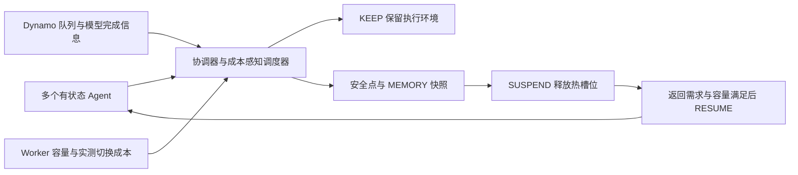

# AgentCloud Course

**面向有状态 AI Agent 的高密度复用与成本感知调度系统。** AgentCloud 利用模型等待和交互间隙释放沙箱资源，让更多有状态 Agent 共享有限的执行槽位，并通过调度算法平衡资源占用、快照与恢复成本以及交互尾延迟。

[](https://github.com/lilong555/agentcloud-course/actions/workflows/course.yml)

原项目已验证 **64 个有状态 Agent 共享 4 个 gVisor 热槽位，实现 16× 沙箱复用**。复用倍率按会话数与热槽位数之比计算，资源消耗和请求延迟由对应负载的实测结果给出。课程围绕这条技术主线开展需求调研、调度策略分析与改进、配对实验和演示。

## 产品故事

运行多个 AI Agent 的平台需要为每个任务保存进程状态、文件和工具上下文。Agent 在执行工具与等待模型回答之间反复切换，等待阶段持续占用执行环境会挤压其他任务的资源；频繁挂起又会增加快照、存储和恢复开销。

AgentCloud 将长期存在的任务状态与短期使用的执行槽位解耦：等待期间在安全点保存状态并释放槽位，实际返回需求到达后恢复执行。调度器结合剩余等待估计、实测切换成本、待恢复需求和 Worker 容量，选择保留、挂起或恢复，让有限的热槽位服务更多 Agent。

**产品价值是在既定资源预算下提高有状态 Agent 的承载密度，并控制资源成本与交互延迟。** 调度算法决定何时复用资源、何时保留环境；状态恢复与持久回执为这些决策提供执行基础。完整叙事见[产品故事](docs/course/PRODUCT_STORY.md)。

## 调度算法与验证

| 决策环节 | 实现依据 | 评价重点 |
| --- | --- | --- |
| 等待估计 | 模型请求、真实闲置窗口、历史条件剩余等待与 Dynamo 准入信息 | 预测支持度、等待阶段连续性和释放时机 |
| 成本感知驻留 | 比较继续占用与快照、持久化、恢复的成本，纳入待恢复需求和容量压力 | 资源积分、切换次数、累计恢复耗时 |
| 高密度复用 | 工具安全点、MEMORY 快照、挂起释放与按需恢复 | 会话数 / 热槽位数、状态连续性、请求完成率 |
| 容量与时延 | 返回需求、可用槽位与恢复队列；研究首次准入排队的影响 | 首次准入等待、交互 TTFT P95、有效吞吐 |

现有 `agentcloud-v2` 在历史样本支持充分时比较条件期望成本；样本不足时采用等待阶段的固定两秒释放期限，并受工具安全点与稳定确认条件约束。课程将复现 TTL2、TTL15、Observed、cost-aware 与 v2 的同机对照，再围绕等待估计、恢复成本和首次准入排队选择改进点。

原项目正式留出实验完成 **50/50 trial、14,400/14,400 请求**，提供不同策略的资源与尾延迟配对数据。较低的资源占用和较短的返回延迟需要联合评价，实验记录同时呈现二者的收益与代价。[调度闭环](docs/SCHEDULING.md) · [v2 算法与配对结果](docs/V2_EVALUATION.md) · [调度瓶颈分析](docs/SCHEDULER_DIAGNOSIS.md)



## 课程资料

| 资料 | 内容 |
| --- | --- |
| [选题说明](docs/course/PROJECT.md) | 高密度复用目标、调度研究问题和验收指标 |
| [产品故事](docs/course/PRODUCT_STORY.md) | 用户、资源矛盾、工作机制与产品价值 |
| [需求调研报告](docs/course/RESEARCH_REPORT.md) | 源码与实验依据、用户假设及调度问题 |
| [调研计划表](docs/course/RESEARCH_PLAN.md) | 资源需求访谈、策略分析和实验准备 |
| [团队分工](docs/course/TEAM.md) | 4–5 人角色与认领方式 |
| [协作规范](CONTRIBUTING.md) | Issue、PR、评审、测试及 AI 使用记录 |

第 1 次课（第 9 周）的 GitHub 检查入口：[选题 Issue](https://github.com/lilong555/agentcloud-course/issues/1)、[Pull Requests](https://github.com/lilong555/agentcloud-course/pulls)、[持续集成](https://github.com/lilong555/agentcloud-course/actions)、[主分支保护](https://github.com/lilong555/agentcloud-course/settings/branches)。

## 快速运行

推荐 Linux x86_64 或 WSL2 Ubuntu，准备 Git、Python 3.10+、Make 和 C 编译器。

```bash
git clone https://github.com/lilong555/agentcloud-course.git
cd agentcloud-course
make bootstrap
python3 scripts/upstream.py --fetch substrate
make demo
```

`make demo` 使用确定性模型与本地 VOLUMES 文件恢复，验证写文件、重复请求回执、安全点、挂起、模型结果认领和恢复后的内容，输出 `docs/evidence/service-local-demo.json`。它用于复现生命周期协议；高密度 MEMORY 复用及调度性能采用[真实 Substrate 部署](deploy/substrate/README.md)、[Dynamo CPU Mocker](experiments/dynamo/README.md)和[v2 配对实验](docs/V2_EVALUATION.md#复现)验证。

```bash
make check   # Go 竞态检测、静态检查、Python 测试与状态回放
make build   # 构建 bin/agentcloud
```

Course CI 在 PR 和主分支更新时执行检查与基础演示。真实沙箱与规模实验通过手动工作流运行，记录源码、配置、随机种子、完整请求分母及资源清理结果。

## 代码与技术文档

| 目录 / 文档 | 用途 |
| --- | --- |
| `internal/control/`、`internal/policy/` | 生命周期调度、等待估计、成本决策与恢复 |
| `internal/adapters/`、`runtime/` | Substrate / Dynamo 接入与 Agent 运行时 |
| `bench/`、`tests/` | 策略对照、资源测量、配对分析及回归测试 |
| `scripts/`、`deploy/` | 环境准备、运行与部署 |
| `docs/course/` | 选题、产品故事、需求和课程计划 |
| [架构](docs/ARCHITECTURE.md)、[API](docs/API.md) | 系统与协议依据 |
| [AgentCloud 技术说明](README.upstream.md) | 原项目设计、实验结果与证据索引 |

## 来源与许可

复用来源：[lilong555/agentcloud](https://github.com/lilong555/agentcloud)，基线提交 [`d9ed974`](https://github.com/lilong555/agentcloud/commit/d9ed974d22a0d56cc36f4507f7236128c842bc49)。仓库保留源码、提交历史、实验材料与许可证；已有结果按各自报告的环境与范围引用。课程贡献通过本仓库的 Issue、PR、策略实现和实验记录追踪。

项目采用 [Apache-2.0](LICENSE)，第三方来源和许可见 [NOTICE](NOTICE) 与 [licenses/](licenses/)。
