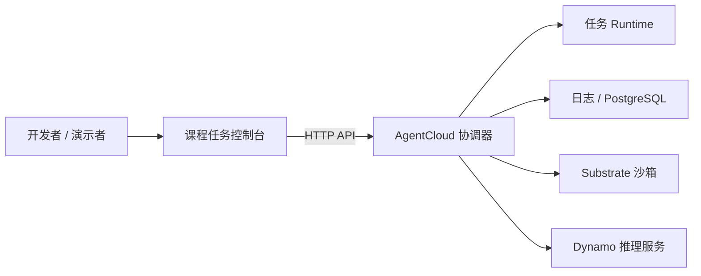

# AgentCloud Course

**面向多智能体的有状态任务执行与资源调度平台。** 本项目面向运行 AI 编程助手、实验任务和自动化工具的开发者，提供会话管理、任务暂停与恢复、工具执行回执及资源状态观察能力。

[](https://github.com/lilong555/agentcloud-course/actions/workflows/course.yml)

课程开发以 AgentCloud 为基础，围绕**任务控制台、执行过程展示和可复现演示**开展需求调研、设计、实现与测试。已有服务承担执行与恢复，课程功能通过现有 HTTP API 接入。

## 课程资料

| 资料 | 内容 |
| --- | --- |
| [选题说明](docs/course/PROJECT.md) | 用户、问题、复用能力、课程开发目标与验收标准 |
| [需求调研报告](docs/course/RESEARCH_REPORT.md) | 基于源码和文档的资料调研、需求假设与技术可行性 |
| [调研计划表](docs/course/RESEARCH_PLAN.md) | 访谈、问卷、场景验证、负责人和交付安排 |
| [团队分工](docs/course/TEAM.md) | 4–5 人角色与认领方式 |
| [协作规范](CONTRIBUTING.md) | Issue、分支、PR、评审、测试及 AI 使用记录 |
| [AI 使用记录](docs/course/AI_USAGE.md) | 辅助工具、产出范围与核验记录 |

第 1 次课（第 9 周）的 GitHub 检查入口：[选题 Issue](https://github.com/lilong555/agentcloud-course/issues/1)、[Pull Requests](https://github.com/lilong555/agentcloud-course/pulls)、[持续集成](https://github.com/lilong555/agentcloud-course/actions)、[主分支保护](https://github.com/lilong555/agentcloud-course/settings/branches)。

## 项目能力

| 层次 | 能力 | 课程用途 |
| --- | --- | --- |
| Go 协调器 | 会话、工具回执、检查点、挂起、恢复、鉴权 | 任务管理与状态操作的服务基础 |
| Python Runtime | 工具调用、运行循环、模型结果认领 | 展示任务的完整执行过程 |
| 持久化与诊断 | 本地日志、PostgreSQL、事件与指标接口 | 状态追踪、失败定位与测试记录 |
| Substrate / Dynamo 集成 | 沙箱恢复与推理调度 | 进阶演示和调度实验 |

课程计划交付的控制台包含会话列表、会话详情、暂停与恢复、工具回执和事件展示。具体交互与优先级由需求调研确认，验收条目见[选题说明](docs/course/PROJECT.md)。



## 快速运行

推荐 Linux x86_64 或 WSL2 Ubuntu，准备 Git、Python 3.10+、Make 和 C 编译器。

```bash
git clone https://github.com/lilong555/agentcloud-course.git
cd agentcloud-course
make bootstrap
python3 scripts/upstream.py --fetch substrate
make demo
```

`make bootstrap` 安装并校验项目锁定的 Go 工具链。`upstream.py` 获取锁定版本的 Substrate 并应用项目集成源码。`make demo` 启动本地服务，验证文件写入、重复请求回执、检查点、挂起、模型结果认领和恢复后的文件内容，结束后清理临时服务。结果输出至 `docs/evidence/service-local-demo.json`。

基础演示采用确定性模型与本地文件恢复，适合课堂复现；真实沙箱内存恢复见 [Substrate 部署](deploy/substrate/README.md)，真实推理集成见 [Dynamo 运行说明](experiments/dynamo/README.md)。

```bash
make check   # Go 竞态检测、静态检查、Python 测试与状态回放
make build   # 构建 bin/agentcloud
```

Course CI 在 PR 和主分支更新时执行检查与演示。完整集成和硬件实验保留为手动工作流，按对应运行说明准备环境。

## 代码与技术文档

| 目录 / 文档 | 用途 |
| --- | --- |
| `cmd/agentcloud/`、`internal/` | 协调器、控制逻辑、存储与适配器 |
| `runtime/`、`adapters/` | Agent 运行时与框架适配 |
| `tests/`、`fixtures/` | 回归测试与固定输入 |
| `scripts/`、`deploy/` | 环境准备、运行与部署 |
| `docs/course/` | 课程需求、计划与团队资料 |
| [架构](docs/ARCHITECTURE.md)、[API](docs/API.md) | 课程实现的接口依据 |
| [AgentCloud 技术说明](README.upstream.md) | 原项目设计、实验结果与证据索引 |

## 来源与许可

复用来源：[lilong555/agentcloud](https://github.com/lilong555/agentcloud)，基线提交 [`d9ed974`](https://github.com/lilong555/agentcloud/commit/d9ed974d22a0d56cc36f4507f7236128c842bc49)。仓库保留其源码、提交历史、实验材料与许可证；原项目实验的来源和运行条件见各自报告。课程贡献通过本仓库的 Issue、PR、测试和演示记录追踪。

项目采用 [Apache-2.0](LICENSE)，第三方来源和许可见 [NOTICE](NOTICE) 与 [licenses/](licenses/)。
