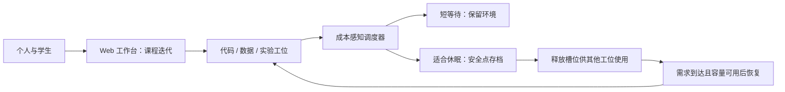

# AgentCloud · 个人 AI 云端工作台

**给每个任务一个云端 AI 工位，回来接着做。**

AgentCloud 面向大学生、科研人员和个人开发者，产品目标是在浏览器里管理多个能写代码、处理数据、跑实验的 AI 助手：每个任务拥有独立工作区，等待时按需保存现场、让出算力，需要继续时恢复工作。通过**高密度复用与成本感知调度**，让有限的云端资源服务更多个人任务，降低等待期间的资源开销。

[](https://github.com/lilong555/agentcloud-course/actions/workflows/course.yml)

当前已具备会话管理、工具执行、状态恢复、调度器和实验工具。**面向个人的 Web 工作台是后续课程迭代目标**，包含多工位卡片、对话与文件工作区、休眠与唤醒状态、资源与成本看板。

## 一个学生的三个 AI 工位

准备课程项目时，你可能同时需要一个助手修代码、一个助手整理实验数据、另一个助手生成图表。任务需要各自的依赖和文件，也会经历模型思考、工具运行和等你确认的间隙。本地多开带来设备负担，云端环境持续驻留增加费用，工作现场丢失又会打断进度。这些场景将通过学生与个人开发者访谈核实。

AgentCloud 希望提供类似游戏机“休眠存档、回来继续”的体验：用户按任务创建工位，离开去上课或吃饭后，回来仍能接着处理已有文件与任务。底层在适合释放资源的等待阶段到达安全点，保存执行现场并释放槽位；新的执行需求到达且容量可用时，再恢复工作。

**用户得到的是可持续使用的个人 AI 工作空间；高密度复用和调度算法决定它的资源效率与响应体验。** 完整场景和演示路线见[产品故事](docs/course/PRODUCT_STORY.md)。

## 核心技术如何变成用户体验

| 核心技术 | 产品特性 | 用户价值与验证 |
| --- | --- | --- |
| 多个有状态 Agent 共享有限热槽位 | 平价多开：为代码、数据和实验分别保留工位 | 原项目验证 64 个 Agent 共享 4 个 gVisor 热槽位，复用倍率为 16×；资源与费用按实际用量评价 |
| 工具安全点、MEMORY 快照与恢复 | 工作现场存档、按需唤醒 | 通过恢复前后的进程状态与文件校验验证连续性；界面计划显示实际恢复耗时 |
| 等待估计与成本感知调度 | 智能休眠，兼顾省资源与及时响应 | 根据等待长度、快照和恢复成本、槽位压力选择保留或休眠，用资源占用与交互延迟联合评价 |
| 持久请求与工具回执 | 刷新后查回结果，重试复用原操作 | 相同操作 ID 和输入读取原回执；结果未知时进入查询与对账流程 |

## 当前基础与课程工作台

| 能力 | 当前基础 | 课程迭代目标 |
| --- | --- | --- |
| 我的 AI 工位 | 创建、列举、查询会话与生命周期 API | 以任务名称展示独立卡片，呈现工作、等待、休眠、唤醒与排队状态 |
| 对话与文件工作区 | 模型请求、结果认领、文件读写和 shell 工具 | 接入对话与工具执行流程，补齐工作台所需的文件列表，展示恢复前后文件内容 |
| 休眠与唤醒 | 安全点、MEMORY 恢复、自主调度与事件记录 | 展示存档进度、恢复耗时及容量等待，让用户知道任务正在经历什么 |
| 资源与成本看板 | 运行事件、指标和配对实验分析 | 展示工位总数、实际占用槽位、资源积分与恢复开销；按明确基线和单价计算节省与费用估算 |
| 策略对照演示 | TTL2、TTL15、Observed、cost-aware 与 v2 实验工具 | 提供受控演示入口，使用相同负载、种子和测量窗口比较 TTL 与 v2 |

看板中的“节省比例”按同一负载下的基线资源积分计算，费用估算列出计算资源、模型调用、快照存储与 I/O 的单价和采集状态。完整需求、指标口径和迭代验收见[选题说明](docs/course/PROJECT.md)。



## 高密度复用与调度证据

原项目已验证 **64 个有状态 Agent 共享 4 个 gVisor 热槽位，实现 16× 会话 / 热槽位复用**。实验使用单 Kind 节点、两个 Worker、四个 FIFO Actor permits、四租户和连续六轮任务，采用真实 Substrate MEMORY 快照恢复与 Dynamo CPU Mocker。16× 描述会话数与热槽位数之比；账单节省取决于实际资源用量、调用量和单价。

原项目正式 Gate 2 留出实验覆盖 N32 / N64、每规模五个种子、五种策略，完成 **50/50 trial、14,400/14,400 请求**。这些历史实验提供系统容量与策略对照证据，课程将另行采集个人用户试用与校园共享场景的记录。

调度器决定什么时候保留、休眠和恢复。现有 `agentcloud-v2` 在历史样本支持充分时比较条件剩余等待下的期望成本，样本不足时采用等待阶段的固定两秒释放期限，实际动作遵守工具安全点和稳定确认条件。正式实验中，相对 TTL15 与 Observed，两种规模均达到资源与交互 P95 联合改善；相对 TTL2，N64 的交互 P95 更高。课程将围绕等待估计、恢复成本或首次准入排队选择一个改进问题，同时报告收益与代价。

[调度闭环](docs/SCHEDULING.md) · [v2 算法与配对结果](docs/V2_EVALUATION.md) · [调度诊断](docs/SCHEDULER_DIAGNOSIS.md) · [快照与成本口径](docs/STORAGE_COSTS.md)

## 课程资料

| 资料 | 内容 |
| --- | --- |
| [选题说明](docs/course/PROJECT.md) | 个人工作台定位、Web MVP、技术研究和验收标准 |
| [SRS v1.0](docs/course/SRS.md) | 功能需求、量化质量指标和技术与运行约束 |
| [用户故事与 Issue](docs/course/USER_STORIES.md) | 24 条故事、负责人、证据及 Given/When/Then |
| [用例图与场景](docs/course/USE_CASES.md) | 主要和次要参与者、17 个用例的主流程与备选流 |
| [需求追溯矩阵](docs/course/TRACEABILITY.md) | 需求、用例、故事与证据的对应关系 |
| [第 03 课交付](docs/course/LESSON03.md) | 课堂讲解、评审、发布和下次课模型草稿 |
| [产品故事](docs/course/PRODUCT_STORY.md) | 目标用户、日常任务、产品体验与演示路线 |
| [需求调研报告](docs/course/RESEARCH_REPORT.md) | 已有技术证据、用户假设与待采集材料 |
| [调研计划表](docs/course/RESEARCH_PLAN.md) | 学生与个人开发者访谈、问卷和原型试用 |
| [团队分工](docs/course/TEAM.md) | 产品与前端、调度、DevOps、测试及 AI 使用职责 |
| [协作规范](CONTRIBUTING.md) | Issue、PR、评审、测试及 AI 使用记录 |

第 1 次课（第 9 周）的 GitHub 检查入口：[选题 Issue](https://github.com/lilong555/agentcloud-course/issues/1)、[Pull Requests](https://github.com/lilong555/agentcloud-course/pulls)、[持续集成](https://github.com/lilong555/agentcloud-course/actions)、[主分支保护](https://github.com/lilong555/agentcloud-course/settings/branches)。

## 快速运行

推荐 Linux x86_64 或 WSL2 Ubuntu，准备 Git、Python 3.10+、Make 和 C 编译器。

```bash
git clone https://github.com/lilong555/agentcloud-course.git
cd agentcloud-course
make bootstrap
python3 scripts/upstream.py --fetch substrate
make demo
```

`make demo` 使用确定性模型与本地 VOLUMES 文件恢复，验证写文件、重复请求回执、安全点、挂起、模型结果认领和恢复后的内容，输出 `docs/evidence/service-local-demo.json`。它用于复现生命周期协议；高密度 MEMORY 复用及调度性能采用[真实 Substrate 部署](deploy/substrate/README.md)、[Dynamo CPU Mocker](experiments/dynamo/README.md)和[v2 配对实验](docs/V2_EVALUATION.md#复现)验证。

```bash
make check   # Go 竞态检测、静态检查、Python 测试与状态回放
make build   # 构建 bin/agentcloud
```

Course CI 在 PR 和主分支更新时执行检查与基础演示。真实沙箱与规模实验通过手动工作流运行，记录源码、配置、随机种子、完整请求分母及资源清理结果。

## 代码与技术文档

| 目录 / 文档 | 用途 |
| --- | --- |
| `internal/control/`、`internal/policy/` | 生命周期调度、等待估计、成本决策与恢复 |
| `internal/adapters/`、`runtime/` | Substrate / Dynamo 接入与 Agent 运行时 |
| `bench/`、`tests/` | 策略对照、资源测量、配对分析及回归测试 |
| `scripts/`、`deploy/` | 环境准备、运行与部署 |
| `docs/course/` | 产品故事、选题、需求和课程计划 |
| [架构](docs/ARCHITECTURE.md)、[API](docs/API.md) | 系统与协议依据 |
| [AgentCloud 技术说明](README.upstream.md) | 原项目设计、实验结果与证据索引 |

## 来源与许可

复用来源：[lilong555/agentcloud](https://github.com/lilong555/agentcloud)，基线提交 [`d9ed974`](https://github.com/lilong555/agentcloud/commit/d9ed974d22a0d56cc36f4507f7236128c842bc49)。仓库保留源码、提交历史、实验材料与许可证；已有结果按各自报告的环境与范围引用。课程贡献通过本仓库的 Issue、PR、功能实现和实验记录追踪。

项目采用 [Apache-2.0](LICENSE)，第三方来源和许可见 [NOTICE](NOTICE) 与 [licenses/](licenses/)。
