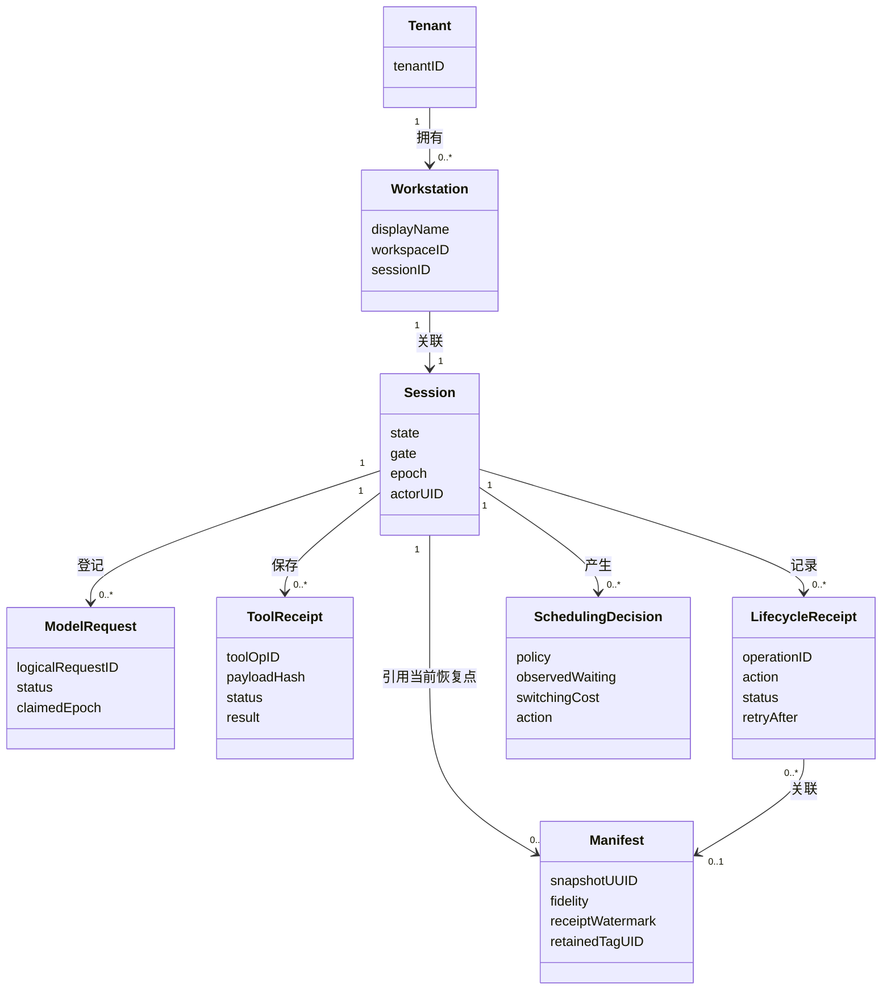
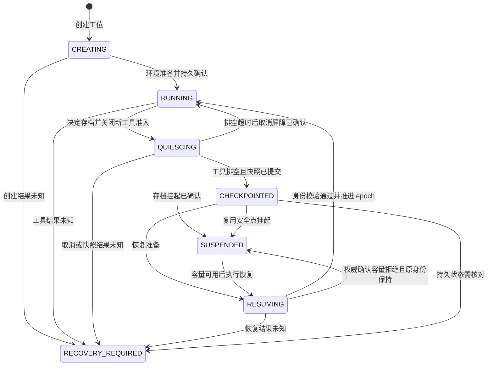
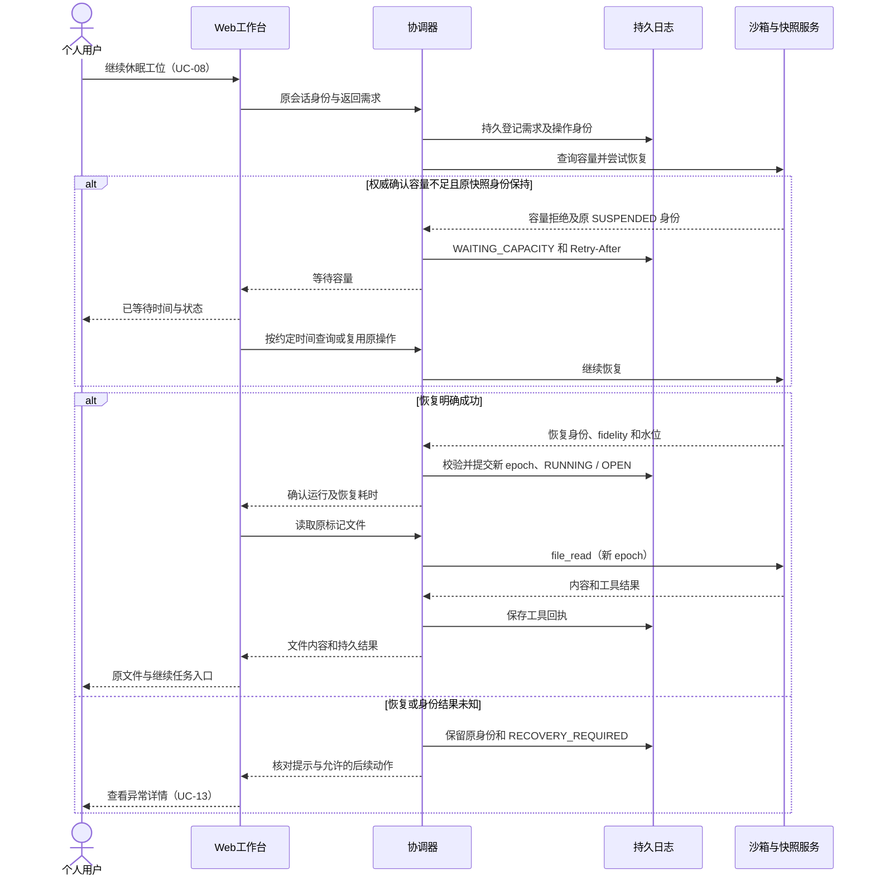

# 分析模型草稿

下次课的分析对象为“个人工位如何保存现场并继续任务”。本稿依据 [SRS](SRS.md) 和 [UC-08](USE_CASES.md#uc-08-唤醒工位)，描述待评审的领域关系、状态与交互。Workstation 表示工作台展示对象，Session、Manifest、请求和回执字段参考[当前控制器类型](../../internal/control/types.go)。

## 类图草稿

领域不变量：一个 workspace 对应一个持久会话；操作 ID 绑定输入；每条请求和回执属于确定租户及会话；恢复基于已提交 manifest 与身份围栏。工位显示名称是课程待补的产品元数据。

## 状态图草稿

这是会话生命周期的分析草稿，图中每条箭头表示一个条件明确的流程。SUSPENDING 等实现中间态可在详细设计继续展开。RECOVERY_REQUIRED 的后续处置依赖核对结果，当前用例保存材料并提示人工处理。

工作台采用三个正交维度组合文字状态：生命周期、模型请求状态、容量等待。模型等待可以发生在 RUNNING 或 SUSPENDED；恢复容量回执可以是 WAITING_CAPACITY，确认容量拒绝后会话保持 SUSPENDED。首次准入队列由运行入口单独计量。页面据三者展示“工作中”“等待模型”“已休眠”“唤醒中”“等待容量”或“需要核对”。

## 顺序图草稿

评审重点：领域对象与需求一致；图中的每条事件有明确来源；容量等待和未知结果均有备选流；Web 状态来自已确认记录。后续设计继续细化接口、并发和恢复围栏，图与需求变更同步进入 PR。
