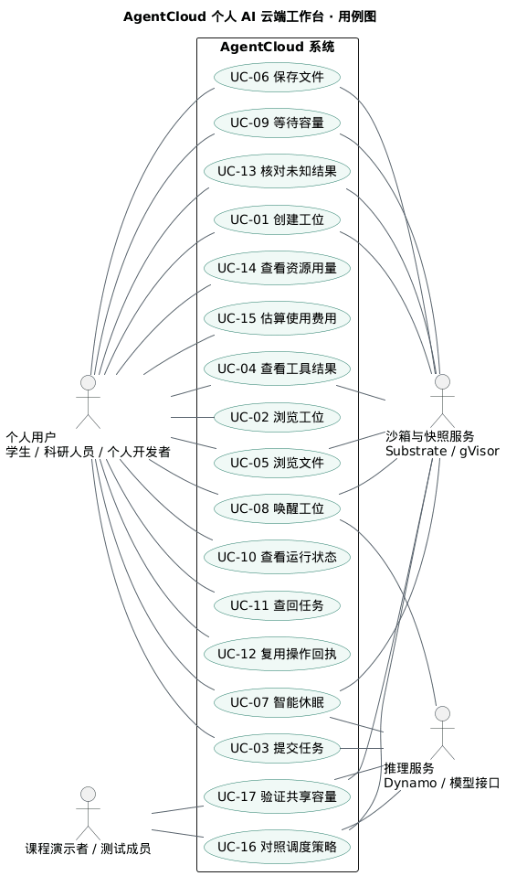

# 用例图与场景详述

系统为 AgentCloud 个人 AI 云端工作台。个人用户为主要参与者；课程演示者和测试成员在独立环境执行对照与核验。推理服务、沙箱与快照服务为次要参与者。协调器、持久日志和工作台界面属于系统内部。

可编辑图源：[PlantUML](diagrams/use-cases.puml)。所有用例采用动宾名称，关联需求见[追溯矩阵](TRACEABILITY.md)。UC-07 的定时决策属于工位任务过程中由真实事件触发的内部行为；UC-17 由测试成员触发容量场景。课程图中使用参与者、椭圆和系统边框。

## UC-01 创建工位

参与者：个人用户；沙箱与快照服务。需求：FR-06、NFR-04、NFR-06。

前置：用户身份有效，输入合法且资源配额允许。触发：用户提交一个新任务的工位名称。

主流程：1. 工作台分配稳定的会话和 workspace 身份；2. 服务端绑定当前租户并持久登记；3. 沙箱服务准备环境，发布创建结果；4. 列表展示新工位，用户进入详情。

备选流：输入缺失时保留表单并提示字段；创建响应中断时沿原会话身份查询；配额或容量错误显示服务端原因；未知创建结果保留原身份供核对。

后置：成功时一个任务对应一个持久工位，文件与其他工作区独立。验收：US-01、US-21、US-23。

## UC-02 浏览工位

参与者：个人用户。需求：FR-06、NFR-05、NFR-06。

前置：身份有效，当前租户存在或尚无工位。触发：用户打开列表或选择卡片。

主流程：1. 按当前租户查询列表；2. 显示任务名称、会话身份与确认状态；3. 用户选择工位；4. 读取同一会话详情，刷新后沿身份继续。

备选流：空列表提供创建入口；鉴权失败提示重新配置身份；查询故障显示数据时间和故障提示；会话详情缺失时刷新列表并保留已知身份。

后置：用户定位原任务，授权范围与列表一致。验收：US-02、US-22、US-23。

## UC-03 提交任务

参与者：个人用户；推理服务。需求：FR-07、NFR-04、NFR-06。

前置：工位和用户身份有效；请求内容合法。触发：用户发送任务指令。

主流程：1. 工作台生成 logical_request_id；2. 服务端持久登记请求并发起模型调用；3. 页面查询首 token 和请求进度；4. 模型完成后按当前 epoch 认领；5. 展示结果或进入工具执行流程。

备选流：挂起或容量紧张时先登记执行需求并显示恢复或排队；模型错误显示持久请求状态；发送结果未知时保持原身份，转 UC-13；刷新后转 UC-11。

后置：模型结果、请求身份和认领记录可追溯。验收：US-03、US-21、US-23。

## UC-04 查看工具结果

参与者：个人用户；沙箱与快照服务。需求：FR-07。

前置：工具输入合法，当前 epoch 和 OPEN gate 允许准入。触发：任务执行工具调用。

主流程：1. 登记工具 ID 和输入；2. 沙箱执行 file_read、file_write 或 shell；3. 服务端发布持久回执；4. 页面呈现 stdout、stderr、退出码或文件结果。

备选流：超时或失败呈现回执错误；单输出超限显示结构化原因；gate 关闭时等待服务端状态允许；未知结果转 UC-13。

后置：用户可逐操作核对结果。验收：US-04。

## UC-05 浏览文件

参与者：个人用户；沙箱与快照服务。需求：FR-08、NFR-04、NFR-06。

前置：当前工位具有可读环境；若需执行资源则按 UC-08 / UC-09 准备。触发：用户进入文件区或点击相对路径。

主流程：1. 列出授权工作区内的文件；2. 选择文件；3. 使用受限相对路径读取；4. 显示原文本、文件大小和身份。

备选流：缺失文件显示 FILE_NOT_FOUND，空文件显示为空；路径越界拒绝访问；超过大小上限显示原因；恢复要求只读检查时遵循允许工具范围。

后置：文件内容与工作区实际状态一致。目录列表是课程待补接口。验收：US-05、US-21、US-23。

## UC-06 保存文件

参与者：个人用户；沙箱与快照服务。需求：FR-08、NFR-06。

前置：当前 epoch、OPEN gate、合法路径和大小均满足写入要求。触发：用户提交编辑后的内容。

主流程：1. 分配稳定 tool_op_id；2. 持久登记写入；3. 执行文件写入并提交结果；4. 读回核验内容与摘要；5. 页面显示已保存。

备选流：受控失败保留编辑文本与服务端原因；重复提交转 UC-12；未知结果转 UC-13；路径越界和内容超限按错误回执处理。

后置：成功结果对应可读取的文件内容与回执。验收：US-06、US-23。

## UC-07 智能休眠

参与者：个人用户的任务流程；推理服务、沙箱与快照服务配合。需求：FR-02。

前置：真实模型等待或显式闲置窗口已登记，调度观测满足安全要求。触发：请求状态、闲置事件或调度采样到达。

主流程：1. 估计剩余等待和切换成本；2. 结合容量比较保留与释放代价；3. 选择 KEEP 或挂起；4. 挂起时关闭新工具准入并等待已有工具完成；5. 提交快照和 manifest；6. 释放槽位，显示休眠。

备选流：v2 样本不足采用等待阶段固定两秒期限；执行需求到达时重新核验；工具排空超时按取消确认恢复原 gate 并记录冷却；未知结果保留材料并转 UC-13。

后置：确认挂起后槽位释放，后续执行能定位恢复材料。验收：US-07。

## UC-08 唤醒工位

参与者：个人用户；推理服务、沙箱与快照服务。需求：FR-08、NFR-01、NFR-04。

前置：休眠工位有已提交 manifest，用户继续任务或模型完成。触发：登记返回执行需求。

主流程：1. 保留稳定恢复操作身份；2. 检查槽位容量；3. 绑定正确快照和 Actor 身份；4. 恢复并核验 fidelity、manifest 和回执水位；5. 推进 epoch 并打开 gate；6. 继续任务并读取原文件，展示恢复耗时。

备选流：容量不足转 UC-09；身份或快照冲突转 UC-13；VOLUMES 路径按文件恢复展示；恢复与新模型登记竞争时沿服务端结果继续。

后置：任务在已确认的新执行代次继续，文件与 MEMORY 标记按验收记录核对。验收：US-08、US-18、US-21。

## UC-09 等待容量

参与者：个人用户；沙箱与快照服务。需求：FR-03。

前置：请求需要槽位且当前容量紧张。触发：首次准入排队或恢复收到容量回执。

主流程：1. 记录首次准入或恢复等待类型和起点；2. 展示已等待时间；3. 按服务端 Retry-After 或调度进度观察；4. 资源可用后沿原身份继续；5. 记录实际等待和恢复时长。

备选流：权威读取无法确认原 SUSPENDED 身份时转 UC-13；用户刷新后继续查询原请求；依赖故障显示故障状态并保留原操作身份。

后置：每种等待独立计时，同一槽位归还与分配遵守后端约束。验收：US-09。

## UC-10 查看运行状态

参与者：个人用户。需求：FR-05、NFR-04、NFR-05、NFR-07。

前置：会话存在，服务端可提供状态或最近记录。触发：进入页面或收到事件、轮询结果。

主流程：1. 读取会话生命周期；2. 关联当前模型请求、工具和容量记录；3. 映射文字状态与进度时间；4. 同步卡片和详情；5. 展示异常及可执行下一步。

备选流：事件窗口缺口重新读取权威状态；查询故障保留最后更新时间并提示；日志故障 readiness 失败时展示服务异常；未知工具结果转 UC-13。

后置：用户能识别工作、等待、休眠、恢复或待核对。验收：US-10、US-21、US-22、US-24。

## UC-11 查回任务

参与者：个人用户。需求：FR-07、NFR-05、NFR-06、NFR-07。

前置：原逻辑请求身份或工具操作身份可定位。触发：页面刷新、网络恢复或协调器重启后重新查询。

主流程：1. 找到原会话与请求身份；2. 读取持久状态或回执；3. 展示原进度、结果与认领信息；4. 继续原任务。

备选流：请求仍在运行时继续观察；未知结果转 UC-13；鉴权失败提示身份问题；服务尚未 ready 时显示故障和数据时间。

后置：已确认结果保持原内容，请求查询保持原执行计数。验收：US-11、US-22、US-23、US-24。

## UC-12 复用操作回执

参与者：个人用户。需求：FR-07、NFR-01。

前置：同一操作 ID 已持久登记。触发：重复点击、受控重试或重复读取结果。

主流程：1. 校验原 ID 和输入绑定；2. 读取原状态；3. 已完成时返回同一回执；4. 仍在运行时观察原操作。

备选流：输入冲突返回明确错误；未知结果转 UC-13；新操作使用新的操作身份并满足当前 epoch。

后置：相同已完成操作的重放共享原结果与副作用计数。验收：US-12、US-18。

## UC-13 核对未知结果

参与者：个人用户；沙箱与快照服务按允许工具范围配合。需求：FR-07、NFR-01、NFR-07。

前置：持久记录为 OUTCOME_UNKNOWN 或会话需恢复核对。触发：用户打开异常详情。

主流程：1. 展示原操作 ID、状态和恢复提示；2. 保留关闭的写入 gate 与原身份；3. 允许时读取文件核对结果；4. 记录核对依据，由人工决定后续处置。

备选流：只读检查条件不足时保留恢复材料与错误；协调器重启后从日志重建同一未决身份；存储故障时展示 readiness 异常。

后置：原未知记录保持可追溯，处置按明确确认的流程继续。验收：US-13、US-18、US-24。

## UC-14 查看资源用量

参与者：个人用户；课程演示者按运行授权查看实验数据。需求：FR-05、NFR-02、NFR-06。

前置：已定义身份范围、运行身份与测量窗口。触发：用户进入资源看板。

主流程：1. 聚合授权工位数与状态；2. 读取槽位、GB·s、恢复与采样记录；3. 分项展示单位、时间和数据来源；4. 提供对应原始记录入口。

备选流：缺测显示待采集和原因；全局实验数据由独立演示权限访问；查询故障保留上次更新时间并提示。

后置：资源与工位数量可回查，租户授权范围一致。验收：US-14、US-19、US-23。

## UC-15 估算使用费用

参与者：个人用户。需求：FR-09。

前置：用量、基线和价格各有明确采集状态。触发：用户查看估算。

主流程：1. 核验配置、负载和窗口一致；2. 计算资源节省；3. 按明确价格与单位估算各成本项；4. 完整数据齐备后汇总费用。

备选流：基线为零时标记比例缺少适用基线；成本缺测时保留待采集和可用分项；资源增加时呈现实测增量。

后置：用户能追溯估算公式和输入。验收：US-15。

## UC-16 对照调度策略

参与者：课程演示者、测试成员；推理服务、沙箱与快照服务。需求：FR-04、NFR-02、NFR-03。

前置：独立演示环境，固定源码、配置、负载和至少三个种子对。触发：演示者执行或读取受控对照运行。

主流程：1. 登记全部计划运行与请求；2. 在同机按固定协议执行 TTL 和 v2；3. 采集资源、TTFT、完成率和恢复记录；4. 计算逐种子配对差及区间；5. 保存原始结果与清理报告；6. 展示资源和等待的收益与代价。

备选流：业务失败保留原分母；清理失败阻断后续运行并保留状态；覆盖率不足时标记缺测；引用历史结果时标注原运行环境和源码。

后置：结果可复算、来源明确。验收：US-16、US-19、US-20。

## UC-17 验证共享容量

参与者：测试成员；沙箱与快照服务、推理服务。需求：FR-01、NFR-02、NFR-03。

前置：真实 MEMORY 环境，明确设备预算、槽位数、会话数和负载。触发：测试成员启动冻结的容量场景。

主流程：1. 准备各会话初始恢复点；2. 在四槽位预算运行六轮任务；3. 测量实际占用、完整请求与状态连续性；4. 记录会话数 / 槽位数；5. 清理所属资源并归档。

备选流：预算不足时在运行前登记实际规模；失败和缺测保留计划分母；清理失败标记所属资源与阻断状态；校园用户参与人数单独登记。

后置：容量、状态校验和清理记录可追溯。验收：US-17、US-19、US-20。
